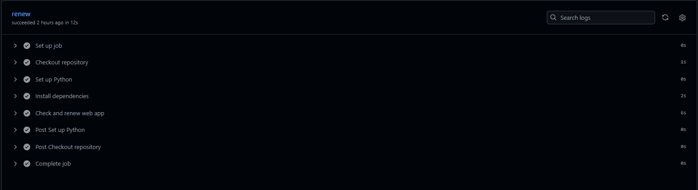

# 📦 PyhtonAnywhere Auto‑Renew Automation


> **Keep your PythonAnywhere account alive without lifting a finger!**  
> This tiny, purpose‑built tool automatically logs in, submits the renewal request, and runs on a schedule via GitHub Actions.

---

## 📖 Table of Contents

1. [✨ Features](#-features)
2. [📸 Demo / Screenshots](#-demo--screenshots)
3. [🛠️ Prerequisites](#-prerequisites)
4. [⚙️ Installation](#-installation)
5. [🚀 Usage](#-usage)
6. [🔧 API Documentation](#-api-documentation)
7. [⚙️ Configuration Options](#-configuration-options)
8. [📁 Project Structure](#-project-structure)
9. [🧪 Testing](#-testing)
10. [🚀 Deployment Guide](#-deployment-guide)
11. [🤝 Contributing](#-contributing)
12. [📜 License](#-license)
13. [👨‍💻 Authors / Contributors](#-authors--contributors)
14. [🙌 Acknowledgements](#-acknowledgements)
15. [📞 Support / Contact](#-support--contact)

---

## ✨ Features

| Feature | Description | Implementation |
|---------|-------------|----------------|
| **Automatic Renewal** | Submits a renewal request to PythonAnywhere without manual steps. | `renew.py` uses `requests` (or optional Selenium) to perform the login and renewal flow. |
| **Scheduled Execution** | Runs daily (or custom) via GitHub Actions. | `.github/workflows/renew.yml` with a `schedule` cron job. |
| **Secure Credentials** | Stores login data in GitHub Secrets or a local `.env` file. | Uses `python-dotenv` to load environment variables. |
| **Logging & Notifications** | Console logs and optional Slack/Email alerts. | Simple `logging` module; can be extended. |
| **Minimal Footprint** | One script + workflow, no heavy dependencies. | Only `requests`, `beautifulsoup4`, and `python-dotenv`. |
| **Extensible** | Easily add retries, back‑off, or multi‑account support. | Modular design; replace or extend `renew.py`. |

---

## 📸 Demo / Screenshots

> **Placeholder** – Add screenshots of the script in action, the GitHub Actions run, or the PythonAnywhere renewal page.


```

```

---

## 🛠️ Prerequisites

- **Python 3.8+** (recommended 3.11)
- **Git** for cloning the repo
- **GitHub account** (for Actions & Secrets)
- **PythonAnywhere account** (username + password)

> **Optional**: A Docker‑enabled environment if you wish to run the script locally in a container.

---

## ⚙️ Installation

```bash
# 1️⃣ Clone the repository
git clone https://github.com/Tusharkamthe23/PyhtonAnywhere_Auto-Renew_Automation.git
cd PyhtonAnywhere_Auto-Renew_Automation

# 2️⃣ (Optional) Create a virtual environment
python -m venv .venv
source .venv/bin/activate      # Windows: .venv\Scripts\activate

# 3️⃣ Install dependencies
pip install -r requirements.txt
```

> **Tip**: If you’re not using a virtual environment, you can install globally with `pip install --user -r requirements.txt`.

---

## 🚀 Usage

### 1️⃣ Local Execution

Create a `.env` file in the project root:

```dotenv
# .env
PYTHONANYWHERE_USER=your_username
PYTHONANYWHERE_PASS=your_password
```

Run the script:

```bash
python renew.py
```

You should see output similar to:

```
[INFO] Logging in as your_username...
[INFO] Successfully logged in.
[INFO] Submitting renewal request...
[INFO] Renewal successful! Confirmation ID: 123456
```

### 2️⃣ Scheduled via GitHub Actions

No extra steps required once secrets are set.

- Add secrets to your repo:  
  `Settings → Secrets → Actions → New repository secret`  
  * `PYTHONANYWHERE_USER`  
  * `PYTHONANYWHERE_PASS`

The workflow runs automatically every day at 02:00 UTC (configurable in `renew.yml`).

### 3️⃣ Custom Schedule

Edit `.github/workflows/renew.yml`:

```yaml
schedule:
  - cron: '0 3 * * *'   # 03:00 UTC daily
```

---

## 🔧 API Documentation

The project is a standalone script, not a library, so there is no public API.  
If you wish to integrate the renewal logic into your own code, you can import the helper functions:

```python
from renew import renew_account

renew_account(
    username="your_username",
    password="your_password",
    notify=False   # Optional: send notification on success/failure
)
```

> **Note**: The `renew.py` module exposes the `renew_account` function; see its docstring for details.

---

## ⚙️ Configuration Options

| Option | Environment Variable | Default | Description |
|--------|----------------------|---------|-------------|
| `PYTHONANYWHERE_USER` | **Required** | – | Your PythonAnywhere username |
| `PYTHONANYWHERE_PASS` | **Required** | – | Your PythonAnywhere password |
| `NOTIFY_SLACK_WEBHOOK` | Optional | – | Slack webhook URL for notifications |
| `RETRY_COUNT` | Optional | `3` | Number of retry attempts on failure |
| `RETRY_DELAY` | Optional | `30` | Seconds between retries |

---

## 📁 Project Structure

```
PyhtonAnywhere_Auto-Renew_Automation/
├── .github/
│   └── workflows/
│       └── renew.yml          # GitHub Actions workflow
├── .gitignore                 # Excludes .env, venv, etc.
├── renew.py                   # Main automation script
├── requirements.txt           # Python dependencies
├── README.md                  # This file
└── .env (ignored)             # Optional local credentials file
```

---

## 🧪 Testing

> **No tests are currently included.**  
> To add tests:

```bash
pip install pytest
```

Create a `tests/` directory and write tests for `renew.py`. Example:

```python
# tests/test_renew.py
def test_dummy():
    assert True
```

Run tests:

```bash
pytest
```

---

## 🚀 Deployment Guide

The primary deployment method is GitHub Actions.  
If you prefer Docker:

```bash
# Dockerfile
FROM python:3.11-slim
WORKDIR /app
COPY requirements.txt .
RUN pip install --no-cache-dir -r requirements.txt
COPY renew.py .
CMD ["python", "renew.py"]
```

Build & run locally:

```bash
docker build -t pyany-renew .
docker run -e PYTHONANYWHERE_USER=... -e PYTHONANYWHERE_PASS=... pyany-renew
```

---

## 🤝 Contributing

1. Fork the repo.
2. Create a feature branch: `git checkout -b feature/awesome-feature`.
3. Commit your changes.
4. Push the branch and open a Pull Request.

Please adhere to the following guidelines:

- Keep commits small and focused.
- Add tests for new functionality.
- Update documentation if you add new features.
- Follow the [PEP 8](https://www.python.org/dev/peps/pep-0008/) style guide.

---

## 📜 License

This project is licensed under the **MIT License**.  
See the [LICENSE](LICENSE) file for details.

---

## 👨‍💻 Authors / Contributors

- **Tusharkamthe23** – *Initial work* – [GitHub](https://github.com/Tusharkamthe23)

Feel free to open an issue or submit a pull request!

---

## 🙌 Acknowledgements

- **PythonAnywhere** – For providing a platform that this tool helps maintain.
- **GitHub Actions** – For the free, cloud‑based scheduler.
- **Shields.io** – For the badges.
- **Stack Overflow** – For countless helpful answers.

---

## 📞 Support / Contact

Have questions or need help?  
- Open an issue in the repository.  
- Email me at: `tusharkamthe23@example.com`  
- Slack channel: `#pythonanywhere-renew` (invite link: TBD)

Happy coding and never miss a renewal again! 🚀